# Dashboard redesign: a proposal

**Status: proposal. Nothing here is built.** It is a brief for one decision: which of nine directions, drawn in
three rounds, the dashboard should be redrawn in. Once a direction is chosen, the plan at the end says what changes, in
what order and in which files.

The aim is a dashboard that reads as something a person made for running a Discord bot. Today it reads as a
generated template: a dark page with a glow, a starfield, a card around everything and a tinted icon square in
every card. The brief keeps every feature, route and permission exactly as it is. Only the visual design changes.

Each direction is mocked up for the same two screens, the server overview and **Welcome and goodbye**, with the
second screen also shown at phone width. A, B and C are static HTML. D to I are clickable prototypes built with
Tailwind and [Motion](https://motion.dev), because their navigation and motion are the point and a still cannot
show either. The pages use invented data: a server called Testify
HQ with 1,234 members, and people called Orbit, Nova, kate and Juniper.

| Direction                              | Overview                                                                  | Welcome and goodbye                                                  | Phone                                  |
| -------------------------------------- | ------------------------------------------------------------------------- | -------------------------------------------------------------------- | -------------------------------------- |
| [A. Plain settings](#a-plain-settings) | [png](a-plain/overview.png) · [html](a-plain/overview.html)               | [png](a-plain/welcome.png) · [html](a-plain/welcome.html)            | [png](a-plain/welcome-phone.png)       |
| [B. Speaks Discord](#b-speaks-discord) | [png](b-discord/overview.png) · [html](b-discord/overview.html)           | [png](b-discord/welcome.png) · [html](b-discord/welcome.html)        | [png](b-discord/welcome-phone.png)     |
| [C. Logbook](#c-logbook)               | [png](c-logbook/overview.png) · [html](c-logbook/overview.html)           | [png](c-logbook/welcome.png) · [html](c-logbook/welcome.html)        | [png](c-logbook/welcome-phone.png)     |
| [D. Columns](#d-columns)               | [png](d-columns/overview.png) · [prototype](d-columns/index.html)         | [png](d-columns/welcome.png)                                         | [png](d-columns/welcome-phone.png)     |
| [E. Switchboard](#e-switchboard)       | [png](e-switchboard/overview.png) · [prototype](e-switchboard/index.html) | [png](e-switchboard/welcome.png)                                     | [png](e-switchboard/welcome-phone.png) |
| [F. Slash](#f-slash)                   | [png](f-slash/overview.png) · [prototype](f-slash/index.html)             | [png](f-slash/welcome.png) · [command bar](f-slash/command-bar.png)  | [png](f-slash/welcome-phone.png)       |
| [G. Sentences](#g-sentences)           | [png](g-sentences/overview.png) · [prototype](g-sentences/index.html)     | [png](g-sentences/welcome.png) · [choosing](g-sentences/picking.png) | [png](g-sentences/welcome-phone.png)   |
| [H. Line map](#h-line-map)             | [png](h-linemap/overview.png) · [prototype](h-linemap/index.html)         | [png](h-linemap/welcome.png) · [the ride](h-linemap/ride.png)        | [png](h-linemap/map-phone.png)         |
| [I. Channels](#i-channels)             | [png](i-channels/overview.png) · [prototype](i-channels/index.html)       | [png](i-channels/welcome.png) · [dragging](i-channels/dragging.png)  | [png](i-channels/welcome-phone.png)    |

**Recommendation:** make E's switchboard the server's home, keep A's plain rows for each feature's full settings,
let F's `/command` names drive the search bar, and draw every message the bot will post the way Discord draws it.
The reasons are in [the recommendation](#recommendation).

> [!NOTE]
> The mockups load their fonts from Google Fonts so that they open in a browser with nothing installed. The
> dashboard itself cannot do that, because the CSP allows no outside font host and Testify never phones home. The
> real build self-hosts each font in `dashboard/public/fonts`, as it does today. Every typeface here is under the
> SIL Open Font License, and the six in D, E and F were checked to include Cyrillic, which the Russian dashboard
> needs.

---

## What makes it read as generated today

Measured against the screenshots in [`../screenshots/`](../screenshots/) and the tokens in
`dashboard/src/index.css`. Each item is a pattern that turns up across generated dashboards. Any one of them on its
own is fine. All of them together are what reads as generated.

1. **Something is always moving behind the page.** Every screen draws a WebGL starfield (`components/motion/
Backdrop.tsx`, mounted in `AppShell` and `SiteShell`). Under it, `body` carries two radial gradients in the
   accent colours (`index.css`, the `body` rule in `@layer base`). The page never sits still on a plain background.
2. **Near-black with a violet glow.** The background is `#07070b`, cards are `#12121c` and the primary is
   `#7c3aed`. A violet accent on near-black is the most common default in generated interfaces.
3. **A card around everything.** The overview is a grid of cards, and so are the settings, the stat tiles and
   the recent changes. When every group is a box, nothing stands out. The `surface-edge` inset highlight on each
   one adds to the effect.
4. **Eyebrows.** `Eyebrow.tsx` draws a short accent rule, then a letter-spaced mono label in capitals
   ("—— FEATURES"). It sits above page headers and section headings. This is the most recognisable generated
   pattern on the page.
5. **An icon in a tinted square.** Each feature has a tint (`config/features.ts`, guide §19.3), drawn as a
   coloured square holding an icon. Six tints, one per kind of feature, so the colours carry no meaning.
6. **Numbers without a sentence.** The overview opens with stat tiles: a large mono number over a small label.
   The reader has to work out what the numbers mean, when the page could say it.
7. **Pills.** On and Off, counts and statuses all use the same rounded badge, so they all carry the same weight.
8. **Type picked to look technical.** Space Grotesk for headings, Inter for body text and JetBrains Mono for
   numbers. Each is a good face, but this pairing is a common default.

What is **not** wrong: the structure. The routes, the sidebar sections, the order of a settings screen, the
permission warnings, the undo and the server switcher are all sound. The problem is the visual layer around them,
which is why this can be done mostly in tokens and primitives.

## Principles every direction shares

- **Rows, not cards.** A setting is a row: what it is and what it does on the left, the control on the right, a
  hairline underneath. A container is used only for something that is a separate object: a preview of a message, a
  warning that needs action, a dialog.
- **Say it in a sentence.** Every screen opens with one sentence describing how things stand right now, for
  example "New members are greeted in #welcome with a picture card." A sentence replaces a row of stat tiles.
- **Speak Discord.** `#channel` and `@role` are drawn the way Discord draws them. A message the bot will post is
  shown as the message itself, not described.
- **Sentence case.** No letter-spaced capitals and no eyebrows. A heading is a heading.
- **Nothing behind the content.** No glow, no starfield and no gradient wash.
- **Colour has a meaning or it isn't used.** Green means on, grey means off, amber means it needs you, red means
  it destroys something. The accent colour marks only actions and where you are.
- **Type chosen for reading.** A humanist sans for everything, and mono only where characters must line up:
  times, IDs and `{placeholders}`.

## What it was compared with

[Mobbin](https://mobbin.com), the screen library the design skills reach for, needed a paid plan, so it was not
used. The rest is split into sources read for this brief and products drawn from memory, and the table says which
is which.

| Source                                                                                                                                                                                                          | What it gave                                                                                                                                                                                                        | Read for this brief?                  |
| --------------------------------------------------------------------------------------------------------------------------------------------------------------------------------------------------------------- | ------------------------------------------------------------------------------------------------------------------------------------------------------------------------------------------------------------------- | ------------------------------------- |
| [Shopify Polaris, app settings layout](https://polaris.shopify.com/patterns/app-settings-layout)                                                                                                                | The description on the left and the controls on the right, grouped under a plain heading. This is the row in A.                                                                                                     | Yes                                   |
| [GNOME Settings, list rows](https://gitlab.gnome.org/GNOME/gnome-control-center/-/issues/2829)                                                                                                                  | One setting per row inside a list, rather than a card per setting.                                                                                                                                                  | Yes                                   |
| [21st.dev settings component](https://21st.dev/@vijayksingh/components/settings.md)                                                                                                                             | A sample of what a generated settings page looks like today, used as a list of things to avoid.                                                                                                                     | Yes                                   |
| ["I Can Tell AI Built Your Dashboard"](https://usergroups.tableau.com/events/details/tableau-st-louis-tableau-user-group-presents-i-can-tell-ai-built-your-dashboard-and-thats-a-problem/) (Tableau user group) | A talk listing the same marks found above: decoration in place of meaning, and numbers in place of a statement.                                                                                                     | The listing only, not the talk itself |
| Discord's own server settings and channel view                                                                                                                                                                  | The server rail, the settings list grouped like channel categories, the notice strip, the member list, and the way a message and a mention are drawn. The source of B, and of the previews in all three directions. | From memory                           |
| GitHub repository settings                                                                                                                                                                                      | A sidebar of plain words, a heading with a rule under it, and Danger zone as the only coloured section.                                                                                                             | From memory                           |
| macOS System Settings                                                                                                                                                                                           | One sentence under a switch saying what it does.                                                                                                                                                                    | From memory                           |
| Linear, Plausible                                                                                                                                                                                               | Plausible's single sentence at the top in place of tiles, and Linear's restraint with colour.                                                                                                                       | From memory                           |

---

## Round one: three static directions

### A. Plain settings

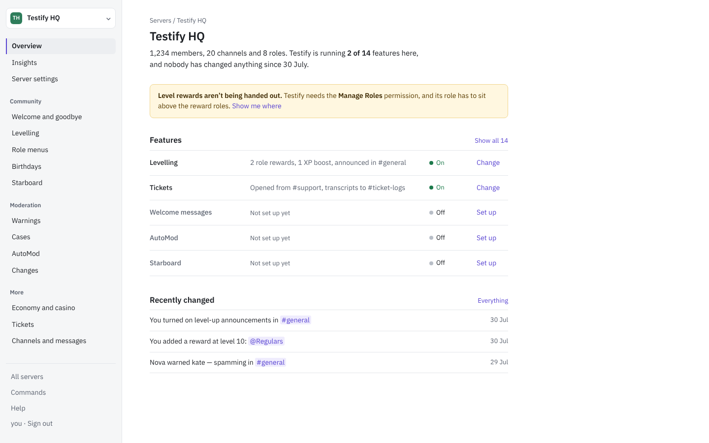

**The idea.** The dashboard as a well-kept settings document. It has a light page, a sidebar of plain words, one
readable column, and headings with a rule under them. Every setting is a row. It looks the way GitHub's settings
or Polaris look, and that is intended: people already know how to read that kind of page.

| Role      | Value                  | Use                                                    |
| --------- | ---------------------- | ------------------------------------------------------ |
| Page      | `#ffffff`              | Background of the content                              |
| Side      | `#f5f6f7`              | Sidebar                                                |
| Ink       | `#1c1f24`              | Text                                                   |
| Muted     | `#5c6370`              | Help text, dates (6.0:1 on white)                      |
| Rule      | `#e3e6ea`              | Hairlines between rows                                 |
| Primary   | `#5843d1`              | Links, switches, current item. Violet kept, but deeper |
| On        | `#1d7a4b`              | "On", "Saved"                                          |
| Attention | `#8a5a00` on `#fff7e0` | The one callout that needs action                      |
| Danger    | `#c22a2a`              | Delete, ban, leave                                     |

**Type.** IBM Plex Sans (400, 500, 600) for everything, and IBM Plex Mono for placeholders and IDs. Plex was drawn
for interfaces and reads as engineered without looking futuristic. Sizes: 13 for help, 14 for body, 16 for section
headings and 24 for the page title.

**Layout.**

```
┌────────────┬──────────────────────────────────────────────┐
│ TH Testify │ Servers / Testify HQ                         │
│            │ Testify HQ                                   │
│ Overview   │ 1,234 members … running 2 of 14 features.    │  ← the sentence
│ Insights   │ ┌ Level rewards aren't being handed out … ┐  │  ← only callout
│            │ Features ─────────────────────── Show all 14 │
│ Community  │ Levelling  2 rewards, #general  ● On  Change │  ← rows
│ Welcome    │ Tickets    From #support        ● On  Change │
│ Levelling  │ Recently changed ─────────────── Everything  │
│ …          │ You turned on level-up announcements…  30 Jul│
└────────────┴──────────────────────────────────────────────┘
```

**Signature.** The sentence at the top of every screen. The overview says how many features are running and when
anything last changed. Welcome and goodbye says where new members are greeted and whether anyone is told when
someone leaves. The page answers "how are things set up?" before the reader looks at a single control.

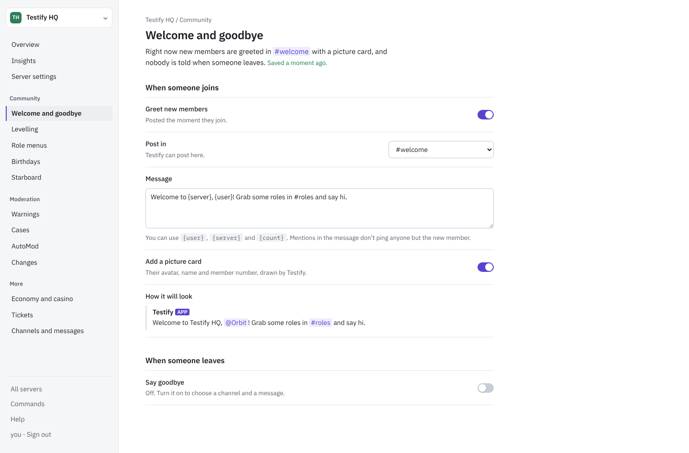

**What it costs.** It is the least work of the three. The routes and navigation stay as they are, and the data
already exists: the overview's API returns each feature's state (`FeatureDetail`), the missing permissions and the
recent changes. Most of the change is tokens plus five primitives.

**The risk.** Plain can tip into anonymous. This direction depends on the sentences being good and on the Discord
previews, which is why the recommendation adds B's preview to it.

---

### B. Speaks Discord

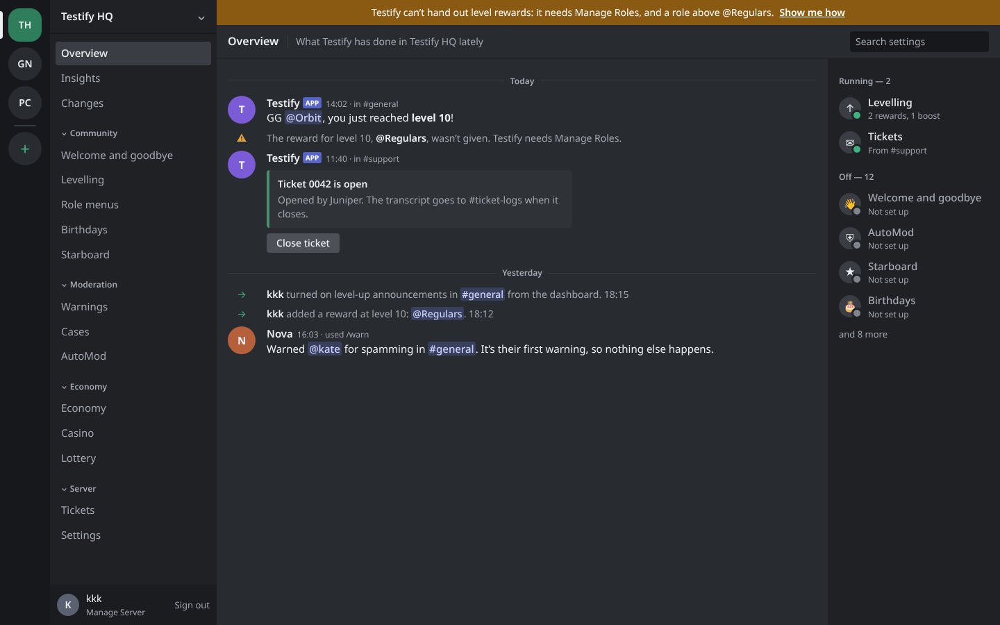

**The idea.** The dashboard arranged the way Discord is arranged, so that someone who runs a server already knows
how to use it. A server rail switches servers. A settings list is grouped like channel categories. The header looks
like a channel's header, with a strip across the top when something needs fixing. Features are listed the way
Discord lists members, under Running and Off.

| Role    | Value                                  | Use                                                              |
| ------- | -------------------------------------- | ---------------------------------------------------------------- |
| Rail    | `#16181b`                              | Server rail                                                      |
| List    | `#1f2125`                              | Settings list, feature list                                      |
| Page    | `#282b30`                              | Content                                                          |
| Field   | `#1b1d21`                              | Inputs                                                           |
| Ink     | `#eceef1`                              | Text                                                             |
| Muted   | `#a2a7b0`                              | Help, times (5.9:1 on page)                                      |
| Rule    | `#383c43`                              | Dividers                                                         |
| Primary | `#23806f`                              | Switches and buttons, a teal of Testify's own (4.8:1 with white) |
| On      | `#3fb27f`                              | Status dot for "running"                                         |
| Notice  | `#8a5a12`                              | The strip across the top (5.9:1 with white)                      |
| Mention | `#c9d0ff` on `rgb(120 140 255 / 0.22)` | `#channel`, `@role`, `@member`                                   |

**Type.** Noto Sans for everything, and Noto Sans Mono for placeholders. Discord's own face, gg sans, is
proprietary. Noto Sans has a similar plain build, which keeps the page close to Discord without copying it.

**Layout.**

```
┌──┬────────────┬───────────────────────────────────┬──────────────┐
│TH│ Testify HQ │ ▓ Testify can't hand out rewards … Show me how ▓ │  ← notice strip
│GN│ Overview   │ Overview │ What Testify has done lately │ Search │
│PC│ Insights   │ ─────────── Today ───────────     │ Running — 2  │
│+ │ ⌄Community │ (T) Testify APP  14:02 in #general│ ● Levelling  │
│  │  Welcome   │     GG @Orbit, you reached level 10│ ● Tickets    │
│  │  Levelling │ ⚠ The reward @Regulars wasn't given│ Off — 12     │
│  │ ⌄Moderation│ → kkk turned on announcements …   │ ○ Welcome    │
│  │ kkk  Sign out                                   │ ○ AutoMod    │
└──┴────────────┴───────────────────────────────────┴──────────────┘
```

**Signature.** What the bot does, drawn as Discord draws it. The overview is a feed of what Testify recently posted
in the server: a level-up with the reward it could not give underneath, a ticket opening, a warning. Each settings
screen sits beside a slice of the channel it posts in, showing the message as members will see it and updating as
you type.

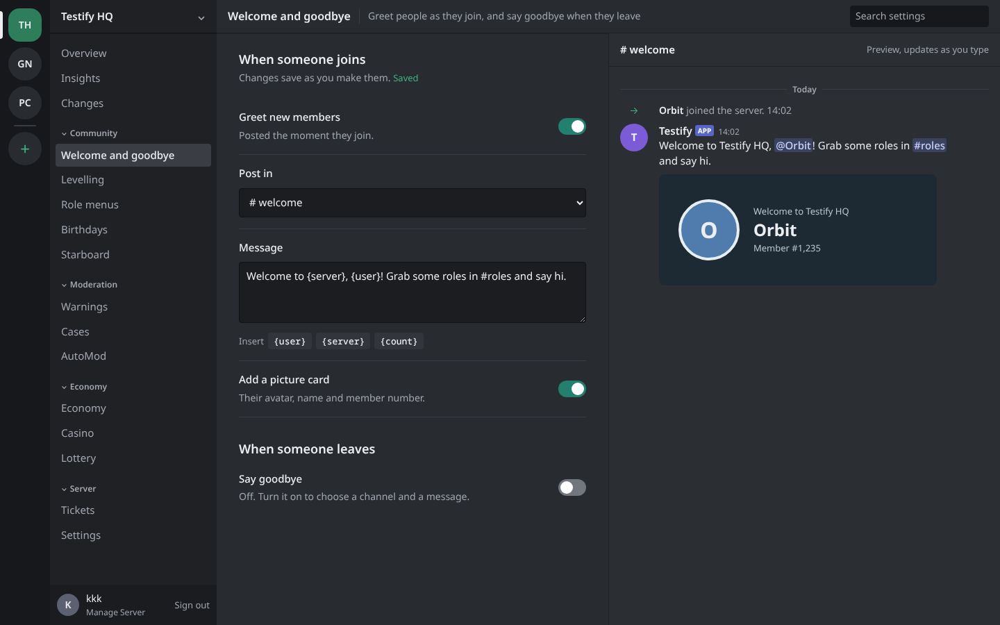

**What it costs.** It is the most work of the three.

- **New layout.** The three columns replace `AppShell`, `Sidebar`, `SidebarSection` and `MobileNav`.
- **New data.** The overview feed needs data the dashboard does not have. The bot does not record what it posts,
  so level-ups and ticket openings would need a new record or a new read. _This is a functional change, outside
  a visual brief. Flagged for whoever builds it._
- **A light theme.** The light half of every token would need designing from scratch.

**The risk.** The closer it gets to Discord, the more it looks like an imitation, and an imitation of Discord's
own interface is a brand problem as well as a taste one. It must never use Discord's blurple, its logo, gg sans or
its exact greys. The mockup keeps away from all four. The one exception is the small APP tag in a preview, which
Discord itself draws on every bot message.

---

### C. Logbook

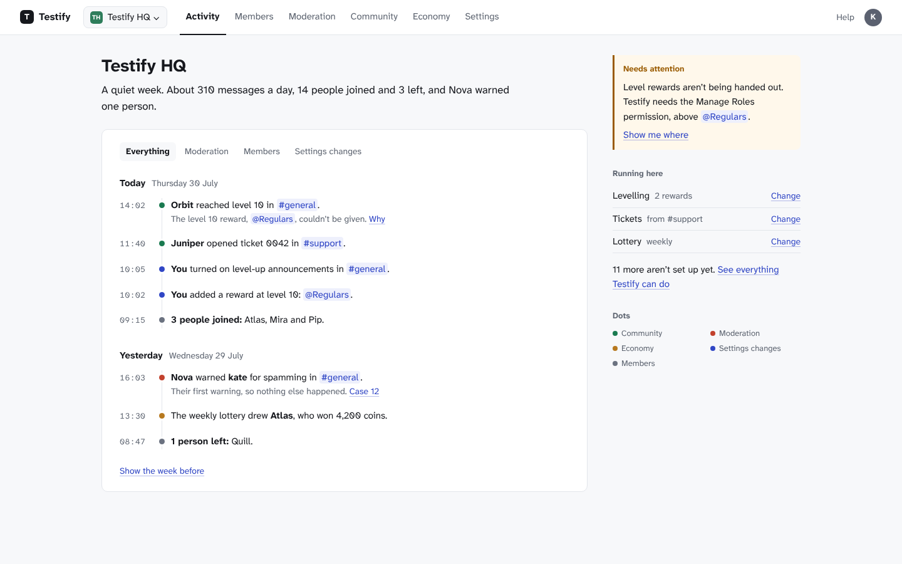

**The idea.** The overview is a record of what happened in the server, written as sentences and grouped by day:
who levelled up, who opened a ticket, who joined, which setting a manager changed and which warning a moderator
gave. Settings pages read like a form you fill in. Navigation moves to the top as six places named for what is done
there: Activity, Members, Moderation, Community, Economy and Settings.

| Role      | Value                                                                                               | Use                                                    |
| --------- | --------------------------------------------------------------------------------------------------- | ------------------------------------------------------ |
| Page      | `#f7f8fa`                                                                                           | Background                                             |
| Sheet     | `#ffffff`                                                                                           | The one container: the page's main subject             |
| Ink       | `#16181d`                                                                                           | Text                                                   |
| Muted     | `#5f6672`                                                                                           | Help, times (5.4:1 on page)                            |
| Rule      | `#e3e6eb`                                                                                           | Dividers                                               |
| Primary   | `#3046c5`                                                                                           | Links, current sub-page, checkboxes (7.5:1 with white) |
| Attention | `#9a5b00` on `#fff8eb`                                                                              | Needs attention                                        |
| Area dots | `#1a7a50` community, `#c2412d` moderation, `#b7791f` economy, `#3046c5` settings, `#6b7280` members | One colour per area of the log, with a key beside it   |

**Type.** Atkinson Hyperlegible Next for text and Atkinson Hyperlegible Mono for times. The Braille Institute
designed the family so that letters easily confused (I, l and 1; 0 and O) look different, which suits a page full
of usernames and IDs. The visible trade-off is a slashed zero in ordinary text ("310"). Some readers will like it
and some will not.

**Layout.**

```
┌────────────────────────────────────────────────────────────────┐
│ T Testify  [TH Testify HQ ⌄]  Activity  Members  Moderation …  │
├──────────────────────────────────────────┬─────────────────────┤
│ Testify HQ                               │ ▌Needs attention     │
│ A quiet week. About 310 messages a day … │ ▌Level rewards …     │
│ ┌──────────────────────────────────────┐ │                     │
│ │ Everything  Moderation  Members  …   │ │ Running here        │
│ │ Today  Thursday 30 July              │ │ Levelling    Change │
│ │ 14:02 ● Orbit reached level 10 …     │ │ Tickets      Change │
│ │ 11:40 ● Juniper opened ticket 0042 … │ │                     │
│ │ 10:05 ● You turned on announcements… │ │ Dots                │
│ └──────────────────────────────────────┘ │ ● Community …       │
└──────────────────────────────────────────┴─────────────────────┘
```

**Signature.** The log. A server manager's first question is usually "what's been going on?", and this answers
it in sentences, in order, with the time down the side.

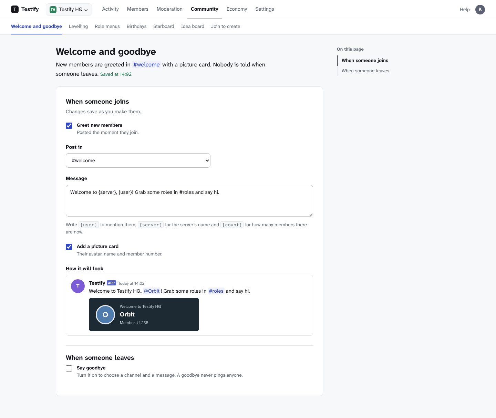

**What it costs.**

- **Navigation.** It changes the most. Forty-odd screens regroup under six places, each with a second row of
  sub-pages. `config/navigation.ts` and the sidebar give way to a top bar.
- **Data.** The log needs one feed merging records that live in several places today:
  - the dashboard audit and Discord's audit log, which `readServerChanges` already merges;
  - joins and leaves from insights;
  - level-ups, tickets, warnings and lottery draws from their own repositories.

  _This is a functional change, outside a visual brief. Flagged for whoever builds it._

**The risk.** A top bar has room for six places but not forty screens, so the second row carries a lot. On a
phone that row scrolls sideways.

---

## Round two: three prototypes with motion

The first round fixed how the dashboard looks. This round is about how it is used: fewer places to go, less on each
screen and a shorter way to the thing you came for. Each direction is one HTML file. Open it in a browser and click:
the overview and Welcome and goodbye both work, along with the switches, the message and its preview, and the
navigation between them. The URL's `#welcome` opens the second screen directly.

They load Tailwind's browser build (`@tailwindcss/browser@4.3.3`) and Motion's script build (`motion@14.3.0`) from
jsDelivr so that they need no build step. The dashboard already runs Tailwind 4 through Vite, so only Motion would be
new. Every animation in them has a reduced-motion path. All three were run with `prefers-reduced-motion: reduce`,
and each one lands in the same end state without moving.

### D. Columns

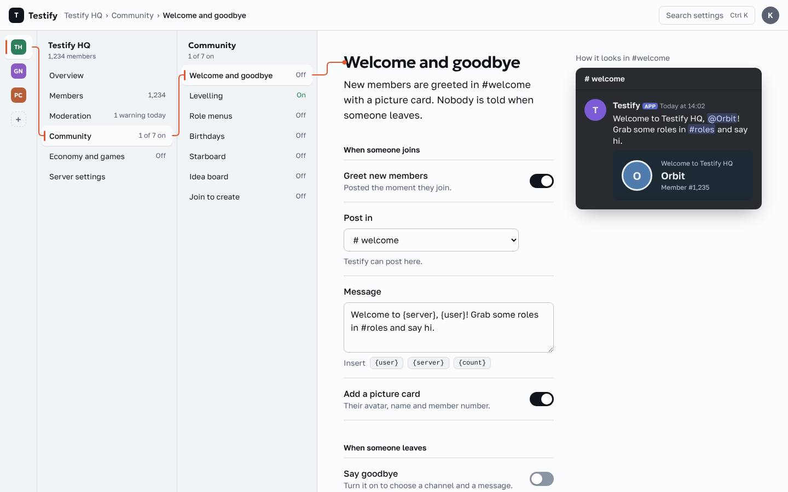

**The idea.** Navigation as columns, like a file browser's column view. You choose a server, then an area such as
Community, then a feature. Each choice opens the next column, and the columns you have passed shrink to give the
settings room. The path you took is always on screen, so you can never be lost three screens deep. On a phone, the
columns become a stack with a back link (‹ Community).

| Role   | Value                 | Use                                                        |
| ------ | --------------------- | ---------------------------------------------------------- |
| Ground | `#e8ecf1`             | Behind everything                                          |
| Sunk   | `#f1f4f7`             | The columns                                                |
| Pane   | `#fbfcfd`             | The content and the chosen row                             |
| Ink    | `#10151c`             | Text                                                       |
| Muted  | `#566070`             | Help and counts (5.8:1 on the columns)                     |
| Path   | `#e4572e` / `#b23a14` | The thread and the chosen row's bar, and link text (5.8:1) |

**Type.** Geologica for headings and Golos Text for everything else.

**Signature.** An orange thread joins the chosen row in each column to the next column, and then to the page's
heading. It draws itself when you choose something, and it redraws as the content scrolls.

**Motion.**

- The new column slides in 24px as it fades up.
- The servers column shrinks to its icons with a spring.
- The page fades in as it moves 16px.
- The thread draws along its length in 0.55s.
- Switches spring, the picture card opens to its own height, the preview flashes faintly when the message changes,
  and "Saved" redraws its tick.

**What it costs.**

- **Layout.** The shell changes completely: `AppShell`, `Sidebar` and `MobileNav` become columns.
- **Width.** The columns take width. Below about 1280px, the page beside them is narrow, so the servers column has to
  shrink sooner. Below 1024px it is the stack.

**The risk.** It is the most unusual of the six. Discord users know a sidebar, and a column view is a new habit to
learn.

### E. Switchboard

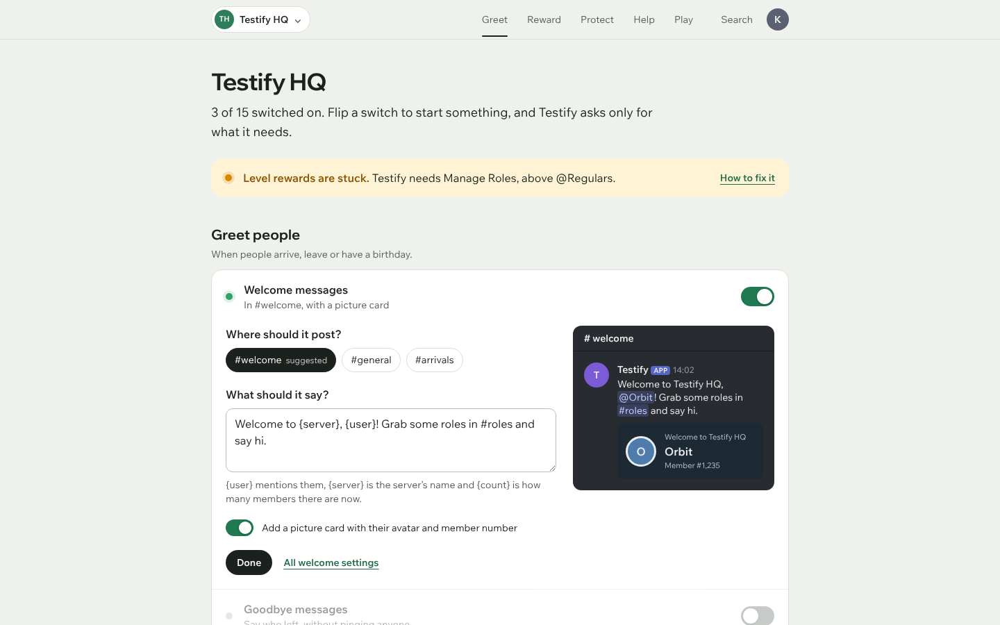

**The idea.** One page holds every feature, grouped by what it does for the server: Greet people, Reward people,
Keep it safe, Help people and Have fun. Each feature is a row with a lamp, a sentence saying what it is doing and a
switch. Flip a switch, and its row opens in place and asks only what the feature needs to start: where to post and
what to say. The live preview sits beside those questions. Everything else waits behind "All welcome settings". The
header's links jump to each group and follow you as you scroll.

| Role      | Value                  | Use                                                        |
| --------- | ---------------------- | ---------------------------------------------------------- |
| Ground    | `#eef1ec`              | A grey with a little green in it                           |
| Panel     | `#ffffff`              | One panel per group                                        |
| Ink       | `#1b211d`              | Text                                                       |
| Muted     | `#586159`              | Descriptions (6.4:1 on a panel)                            |
| On        | `#1f7a52`              | A switch that is on (5.3:1 against the panel)              |
| Off       | `#858e86`              | A switch that is off (3.4:1, past the 3:1 a control needs) |
| Lamp      | `#2fa36b`              | A running feature                                          |
| Attention | `#8a5400` on `#fff3d6` | The one thing that needs you                               |

**Type.** Wix Madefor Display for headings and Wix Madefor Text for everything else.

**Signature.** The switch, and what happens when you flip it.

- The lamp lights with a short pulse.
- The count at the top ("3 of 15 switched on") counts up.
- The row opens, and its questions arrive one after another.
- The rest of the page dims until you press Done.

The next step is always under your pointer, so the page needs no wizard, no modal and no separate setup screen.

**Motion.**

- The knob springs across with a little overshoot.
- The row opens to its own height with a spring, and its four parts stagger in 50ms apart.
- The other rows fade to 45%.
- Choosing a channel gives its chip a small press.
- The group marker under the header slides to the group you are reading.

**What it costs.**

- **A switch per feature is a functional change.** Today each screen writes its own settings, and some features have no
  single on or off. The overview counts many of them as on because something exists: a ticket setup, a role menu, a
  sticky message or a scheduled post (`featureStatus.util.ts`). Each switch needs a rule for what it does, and a route
  to do it. _Outside a visual brief, so flagged for whoever builds it._
- **Deeper settings still need pages.** Levelling's four tabs or the ticket panel's wording would not fit a row. Those
  stay as pages, drawn in A's rows.

**The risk.** A long page. The jump links and the groups carry it, but a server with every feature on gets a long
list of open rows if nobody presses Done.

### F. Slash

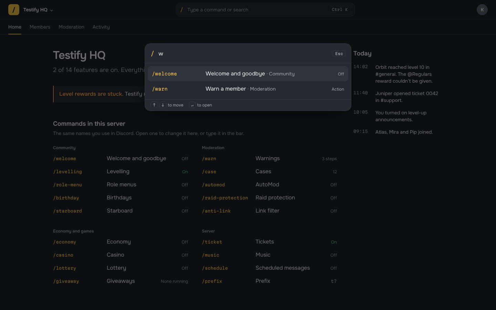

**The idea.** The dashboard speaks the same language as the bot. Every feature is listed under the command that
runs it in Discord (`/welcome`, `/warn`, `/raid-protection`), with what it is and whether it is on. A command bar at
the top opens with Ctrl K or `/` and finds features, actions such as "Warn a member" and people. Choose a result and
you are on its page, where the command name stays as the page's label. The tabs drop to four, Home, Members,
Moderation and Activity, because the bar replaces the long sidebar.

| Role    | Value     | Use                                                         |
| ------- | --------- | ----------------------------------------------------------- |
| Ground  | `#1d2026` | A blue-grey dark, lighter than the near-black used today    |
| Surface | `#262931` | The bar, the panels                                         |
| Ink     | `#eeeef1` | Text                                                        |
| Muted   | `#a3a6b0` | Descriptions (6.7:1)                                        |
| Gold    | `#f0c048` | Command names, a switch that is on, the current tab (9.6:1) |
| On      | `#5cc58d` | "On" in the list                                            |

**Type.** Onest for text and Martian Mono for command names, times and keys.

**Signature.** The command bar.

- **Opening it:** the bar scales in from 97% as it fades.
- **Results:** they arrive 25ms apart as you type.
- **The highlight:** one block slides from row to row with the arrow keys, rather than each row lighting up.
- **Choosing a result:** its `/welcome` label flies from the bar to its place above the page's title. That shows
  you arrived where you asked to go.

**What it costs.**

- **The bar exists already.** Ctrl K already opens quick search (`searchEntries` is built from the sidebar and the
  command catalogue), so the bar is a restyle plus actions and members.
- **The commands page exists too.** It is the commands catalogue (`GET /api/commands`) grouped by area, with each
  feature's state from the overview.
- **The index has to be kept honest.** Every name in the mockup was checked against `docs/commands.md`. In the real
  page the names come from the registry, so they cannot drift.

**The risk.** People who never use slash commands, or never press Ctrl K, rely on the index alone, and a list of
twenty commands is still a list.

## Round three: three more ways in

Every direction so far organises the dashboard by feature. These three each organise it around a different question
a server manager asks, so each one is a way into the same settings rather than a new set of them. They are built
like round two: one HTML file each, Tailwind and Motion from jsDelivr, every animation with a reduced-motion path,
and the typefaces checked for Cyrillic.

### G. Sentences

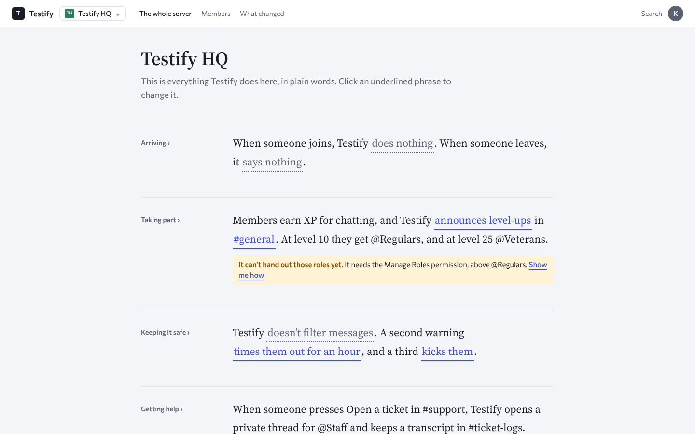

**The question it answers:** "What does the bot actually do here?"

**The idea.** The whole server's setup is written out as plain sentences, one paragraph per part of a member's life,
and the underlined words are the controls. "When someone joins, Testify _does nothing_." Click "does nothing", choose
"greets them", and the sentence grows: "…greets them in _#welcome_ with _"Welcome to {server}…"_ and a picture card."
There is no form to read, because the setting and its description are the same text. Each paragraph's label in the
margin leads to the full page for that part, which is written the same way, with the live preview beside it.

| Role      | Value                  | Use                                                     |
| --------- | ---------------------- | ------------------------------------------------------- |
| Ground    | `#f3f5f9`              | A cool, slightly blue white                             |
| Ink       | `#1a1d24`              | Text                                                    |
| Muted     | `#5d6472`              | Labels, and a setting that is off (5.5:1 on the ground) |
| Token     | `#3a4fd6` on `#eceefe` | An underlined phrase you can change (5.9:1)             |
| Attention | `#8a5400` on `#fff3d6` | The note under a sentence that cannot do what it says   |

**Type.** Source Serif 4 for the sentences, at 22px, and Commissioner for everything around them. It is the one
direction with a serif, because these pages are meant to be read like prose.

**Signature.** The sentence that grows. Turning something on adds the words it needs, and they arrive highlighted
before fading to the page's colour. Turning it off takes them away again.

**Motion.**

- A phrase's menu opens from the phrase itself.
- A changed phrase eases from its old width to its new one, so the rest of the line moves rather than jumps.
- New words fade in on a highlight that clears.
- "Saved" appears under the sentence that changed and fades.

**What it costs.**

- **Translation is the hard part.** A sentence with controls inside it has to stay one translation key with
  placeholders where the controls go (i18next's `Trans`), because German puts the verb last and Russian changes the
  ending of a word with the number before it. Every option has to read correctly in every language's sentence. Of the
  nine directions, this is the one the six dictionaries make most expensive.
- **No new data.** Each phrase writes through the route its page already uses.
- **Screen readers.** Each phrase is a button inside a paragraph, so its accessible name needs the context the
  sentence gives it, for example "does nothing: change what happens when someone joins".

**The risk.** It only works while the sentences stay short. Levelling's four tabs would make a long paragraph, so
deep settings still need a page of rows.

### H. Line map

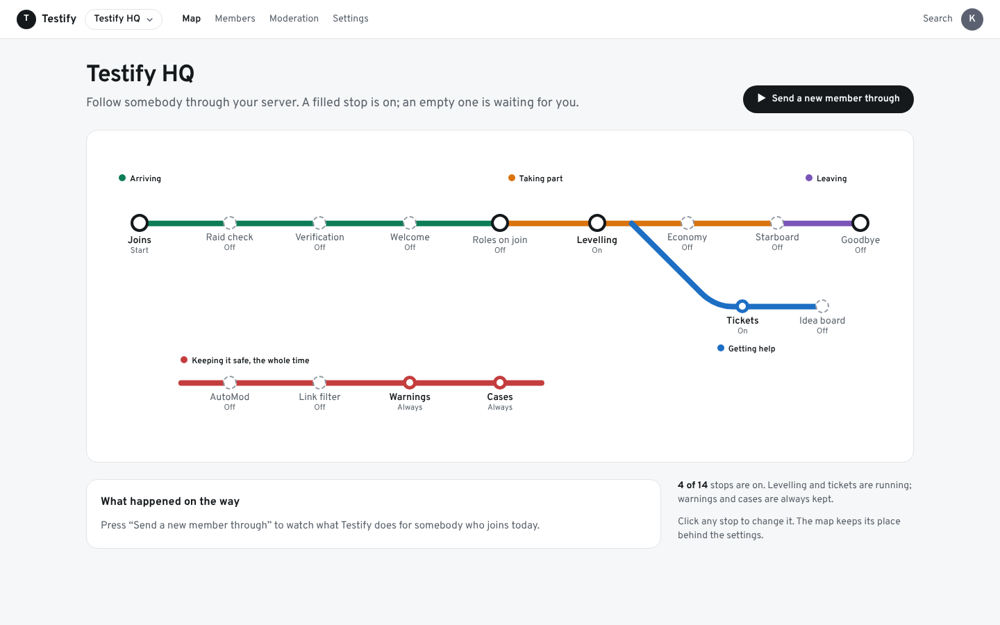

**The question it answers:** "What happens to somebody who joins?"

**The idea.** The server is drawn as a transit map. Each line is a part of a member's life (Arriving, Taking part,
Getting help, Keeping it safe, Leaving), and each stop is a feature. A filled stop is on and an empty one is waiting.
**Send a new member through** sends a rider named Orbit along the line, stop by stop. Under the map, a log says what
each stop did: "Raid check: off, so nobody checks how new the account is." "Welcome: nobody says hello." The ride ends
with a count of how many stops did something and a link to the first one worth turning on. Clicking a stop slides its
settings over the map, so you never lose your place on it. On a phone, the map becomes one vertical line per group.

| Role            | Value     | Use                                                   |
| --------------- | --------- | ----------------------------------------------------- |
| Ground          | `#f6f7f8` | A neutral, very light grey                            |
| Ink             | `#15191c` | Text and the interchange stops                        |
| Muted           | `#59616a` | A stop that is off (5.9:1)                            |
| Arriving        | `#0c7d56` | The line, and its switch and link (5.1:1 on white)    |
| Taking part     | `#d9730d` | The line                                              |
| Getting help    | `#1d6fc4` | The line                                              |
| Keeping it safe | `#c43d3d` | The line                                              |
| Leaving         | `#7a55b8` | The line                                              |
| Stop off        | `#8d96a0` | The dashed ring of an empty stop (3.0:1, the minimum) |

**Type.** Overpass, a face drawn after American road signs, for everything, and Overpass Mono for the times in the
log. The line names are never written in their line's colour: they carry a swatch instead, because orange on white
cannot reach 4.5:1.

**Signature.** The ride. It is the only direction that shows the consequence of a setting rather than the setting
itself, and it makes a missing feature obvious without a warning banner.

**Motion.**

- The rider moves stop to stop with an eased slide and a pause.
- Each stop it reaches sends out a ring.
- Each line of the log slides in as it is written.
- A stop's settings slide in from the right over a dimmed map.
- Turning a feature on fills its stop with a small pop.

**What it costs.**

- **The map is drawn, not generated.** Every stop has coordinates, so adding a feature means placing a stop, like an
  entry in `config/features.ts` with a position.
- **The ride needs no new data.** It is worked out from the current settings, not from anything recorded.
- **Every stop is a real link with a name**, such as "Welcome, off. Open its settings". The drawing itself is hidden
  from screen readers.

**The risk.** The metaphor is the most playful of the nine. Some people will find it charming and some will find it a
gimmick. It also does not scale to forty screens, so it suits the overview, with the feature pages drawn in A's rows.

### I. Channels

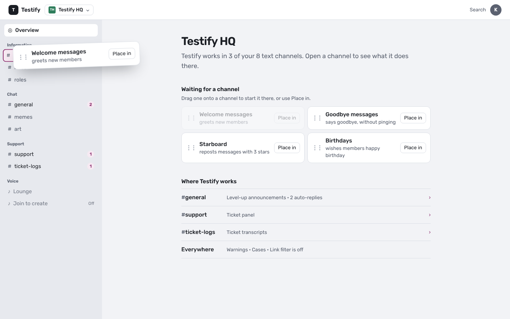

**The question it answers:** "What happens where?"

**The idea.** The navigation is the server's own channel list, the one everybody already knows from Discord. A
channel where Testify does something shows a count, and opening it shows each thing Testify does there as it will
appear in that channel. The welcome message is the message itself: click it to edit the text in place, and leave it
to see the result. Features that are not placed anywhere wait on the overview as chips. Drag one onto a channel to
start it there. **Place in** does the same from the keyboard, and **Move to** moves something that is already placed.

| Role   | Value                  | Use                                          |
| ------ | ---------------------- | -------------------------------------------- |
| Ground | `#f2f3f6`              | The page                                     |
| Side   | `#e7e9ee`              | The channel list                             |
| Ink    | `#1b1e24`              | Text                                         |
| Muted  | `#565d6b`              | Channels with nothing in them (5.5:1)        |
| Accent | `#8a2a6b` on `#f6e9f2` | Counts, the drop target, the editing outline |

**Type.** Rubik for everything, and Fira Mono for `{placeholders}`.

**Signature.** Dragging a feature onto a channel. You pick the chip up and it tilts. The channel under it lights up
and grows a little. When you let go, the chip flies into the channel, the channel's count pops, and you land in the
channel with the feature already there.

**Motion.**

- The dragged chip tilts and lifts, and springs back home if it is dropped on nothing.
- A channel under the chip scales up as a target.
- On a drop, the chip shrinks into the channel's row.
- The message turns into its editor in place and back.
- Moving a feature slides it out of one channel before you arrive in the other.

**What it costs.**

- **The channel list exists.** The dashboard already reads it (`/channels`), and the rule that a channel its reader
  cannot see is named nowhere carries straight over.
- **Where each feature posts is stored per feature.** The overview's data reports a channel for five of them
  (`FeatureDetail` of kind `posting`). The rest read theirs from their own settings, so building this means a map from
  feature to channel fields.
- **Some features live in several channels** (the ticket panel and its transcripts) and some in none (AutoMod,
  warnings), which is what the "Everywhere" row is for.
- **Drag and drop always needs another way.** Place in and Move to are that way here, and every drop target is an
  ordinary link.

**The risk.** A server with eighty channels has a long list. It mirrors Discord's, which helps, but it may want a
"channels Testify uses" filter.

## More ideas, not prototyped

Each of these could be a screen inside whichever direction is chosen, rather than a whole direction.

- **Inbox.** One list of what needs you: open tickets, ideas waiting for a decision, a missing permission, a post
  that failed. You work through it like email, with keyboard shortcuts, and a handled item slides away with an undo.
  Tickets, ideas and permissions are already read by their screens. A post that failed is not recorded anywhere yet.
- **This week.** Everything Testify will do in the next seven days on one agenda: scheduled messages, the lottery
  draw, giveaways ending and birthdays. Each of these already stores its own time. Reminders stay out, because they
  belong to the person who set them, not the server.
- **What does a role get?** A page per role that lists every feature that gives it or depends on it: level rewards,
  role menus, roles on join, DJ roles, ticket staff and the raid alert's ping. It answers "can I delete this role?"
  before somebody finds out the hard way.
- **Try it.** A **Send me a test** button beside anything that posts, which sends the real message to the reader's
  direct messages. `/welcome test` already does this inside Discord.
- **Settings as they were.** A slider back through the server's setup, to see how something was configured last
  week and put it back. The dashboard's own audit records already keep `before` and `after` values
  (`dashboardAudit.schema.ts`). I haven't checked whether changes made with commands in Discord are recorded the same
  way, and the slider would need both.
- **Several servers side by side.** For somebody who manages more than one server: one table, with servers as columns
  and features as rows, and **Copy this setup to…**. Copying is a functional change, and it would have to ask each
  server's own permissions.

## Motion: what moves, and why

The current dashboard moves for its own sake. A starfield drifts behind every page, sections fade in on load and
numbers count up. The prototypes move only when something changed, and only to say what changed.

- **A change of state moves:** a switch, a lamp, "Saved" and a count.
- **A change of place moves:** a column arriving, a row opening and the command name flying to the page title.
- **Nothing moves on load or at rest.** A page opens finished, which is also what a screenshot or a screen reader
  sees.
- **Springs for things you push, tweens for things that appear.** Switches and panels use a spring with a bounce
  of 0.15 to 0.4 and a visual duration of about 0.35s. Fades and the thread are short tweens.
- **Reduced motion is the same page with no movement**, not a different page. Every call goes through one helper
  that sets the duration to zero.

**Bringing Motion into the dashboard.** These sizes were measured by bundling `motion@14.3.0` with esbuild and
gzipping the result, with React left out:

| Import                                               | Gzipped |
| ---------------------------------------------------- | ------- |
| `motion` component from `motion/react`               | 45.1 kB |
| `LazyMotion` + `m` + `domAnimation`, loaded together | 31.0 kB |
| `LazyMotion` + `m`, with `domAnimation` loaded later | 5.6 kB  |
| `animate` from `motion` (the prototypes' build)      | 26.0 kB |
| `animate` from `motion/mini`                         | 3.7 kB  |

The way in is `LazyMotion` with `m` components, with the features imported asynchronously. That puts 5.6 kB in the
first load and the rest in a chunk fetched after it.

Two notes on that:

- **The budget is already full.** The guide records the first load's budget, 200 kB gzipped, as met exactly. So
  even 5.6 kB is a decision: it either needs that much found elsewhere or a higher budget. Deleting `Reveal`,
  `AnimatedNumber` and `useCountUp` returns a little.
- **Removing the backdrop saves no first-load budget.** The three.js chunk is already lazy, so it frees nothing
  there, though it removes the 513 kB chunk AGENTS.md describes.

**Reduced motion in React.** `MotionConfig reducedMotion="user"` is how the React version honours the setting,
alongside the existing `data-motion` attribute that Appearance writes.

**Layout animations.** In React they would use `layout` and `AnimatePresence`, which the prototypes imitate by hand
with heights and transforms. Motion animates through inline styles set from script, which the CSP already allows
(`style-src 'unsafe-inline'`, the same allowance tippy relies on).

---

## Recommendation

**Make E's switchboard the server's home, draw the feature pages in A's rows, let the search bar speak F's
commands, and keep B's preview and graphite.** Each piece answers a different part of "less cluttered, easy to get
around":

- **E removes most of the navigation.** Most visits are "turn this on" or "change where it posts", and the
  switchboard does both without leaving the page. The overview's stat tiles, feature grid and setup checklist all
  become one list of switches that says what is running.
- **A is still how a full feature page should look.** Levelling's tabs, the ticket panel's wording and the casino's
  limits are long forms. A's rows, sentence summaries and lack of cards are the calm way to draw them, and they are
  where "All welcome settings" leads.
- **F's commands make the search bar the shortcut.** Ctrl K already exists. Showing every feature under its Discord
  command, in the bar and as each page's label, ties the two surfaces together for anybody who already knows the bot
  by its commands. Its index of commands replaces the long sidebar for everything that is not on the switchboard.
- **D is the most unusual, and the most expensive to learn.** The thread is worth keeping as an idea, for showing
  where a deep page sits, but the column shell is not recommended.

- **A fixes every item on the list above**, using data the dashboard already has and changes that stay inside
  tokens and primitives. No route, API or permission moves. It is the only one of the three that is purely visual,
  which is what this brief is for.
- **B's preview is what makes it a Discord bot's dashboard.** A screen that posts something should show that
  message as Discord will draw it, right beside the setting that changes it. Welcome and goodbye already has a
  preview (`features/welcome/WelcomePage.tsx`). Restyled and made into one component, it also belongs on
  levelling's announcement, the starboard, the ticket panel, announcements, scheduled messages and birthdays.
- **B's graphite is a better dark theme than near-black.** The dashboard keeps both themes (`light-dark()`). A's
  values become the light half, and B's rail, list and page greys become the dark half, measured by
  `contrast.test.ts` like every other pair.
- **C's log is the best record of what happened, but it needs a new API.** A's "Recently changed" list is the
  version that exists today. The full log is a candidate for later, once somebody decides to build the feed.
- **Motion stays small:** the moves listed under [Motion](#motion-what-moves-and-why), the lazy build, and nothing
  that moves on load.

**Where round three fits.** G, H and I are ways in rather than replacements, and each can sit beside the recommendation
without changing it:

- **G's sentence is the summary line** that A puts at the top of every page, made editable. Start there, with the
  sentence written for the switchboard's rows, and decide on whole pages of sentences only once the translations have
  been tried in German and Russian.
- **H's ride is a second overview.** It suits a server that has just added the bot, because it shows what is missing
  by its consequence. Offer it as a tab beside the switchboard rather than instead of it.
- **I's channel view is a second index.** "What happens in #general" is a question the switchboard cannot answer.
  It reads data the dashboard mostly has, and it gives drag and drop a job that a list does not.

---

## The plan

Laid out as the design audit's three phases. Each step names the files it touches. **None of it starts until a
direction is approved**, and each phase is reviewed in a browser before the next one begins. The re-skin follows the
order in [guide §19.10](../guide.md#1910-re-skinning-the-order-to-do-it-in): the palette first, then the things that
cannot read a token, then contrast and a real browser.

### Phase 1: Critical

These are the changes that most affect how the page reads.

1. **Take away what moves behind the page.**
   - Unmount `Backdrop` from `app/AppShell.tsx` and `features/site/SiteShell.tsx`, and delete it with
     `lib/three/` and its tests. The exception is `lib/three/tokens.ts`, which `lib/consoleGreeting.ts` also reads:
     it moves to `lib/`.
   - Remove the three.js chunk from `manualChunks` in `dashboard/vite.config.ts`, and the dependency itself.
   - Delete the two radial gradients in the `body` rule.
   - AGENTS.md §24 "The WebGL backdrop" goes, and so does its line in guide §19.10.
2. **Swap cards for sections and rows.**
   - Add a `Section` primitive (an `h2` with a rule under it, plus an optional link on the right) and a
     `SettingRow` (label and help on the left, the control on the right, a hairline under it).
   - Keep `Card` only for a preview, a callout and a dialog.
   - `Card.test.tsx` and `spacing.test.ts` change with it. The rule that every block of content starts on the same
     column stays, now as the column of the rows.
3. **Rewrite `PageHeader`.**
   - The eyebrow becomes a breadcrumb (`Testify HQ / Community`), which still names the server, so
     `pageHeader.test.ts` keeps its rule with a different element.
   - A `summary` prop takes the opening sentence. Each screen's sentence is built in the page from the data it
     already reads, following the rule that the server sends data and the page words it. Every sentence is an
     `en.json` key with plurals, in all six languages.
   - `Eyebrow` is deleted.
4. **Rebuild the overview** (`features/guild-overview/`):
   - the summary sentence;
   - one callout for missing permissions (`MissingPermissions` already exists);
   - a features list of rows (name, what it is doing, on or off, Change);
   - "Recently changed" as a list.

   `StatTile` and the feature grid go. The data is already in the overview response.

5. **Make the sidebar plain words** (`app/layout/Sidebar.tsx`, `SidebarLink.tsx`, `sidebarStyles.ts`).
   - The current item is marked by weight and a 2px bar.
   - Icons stay only at the icon-only rail width, where they are the only thing to click. They are monochrome and
     16px, with no tile behind them.

### Phase 2: Refinement

These change the palette, type and the smaller pieces.

6. **New palette in `@theme`.**
   - A's values become the light half and B's graphite the dark half. The role names stay, so every component
     follows.
   - The six `--color-feature-*` tints are removed, because status colours are the only colours with a meaning.
   - The twelve accents on Appearance stay. Each block is re-measured against the new backgrounds by
     `contrast.test.ts`, and any that fail are darkened until they pass.
   - Then the four things that cannot read a token (guide §19.10, step 2): the select chevron, the body wash (now
     gone), the tippy theme block and the `prefers-contrast: more` block.
7. **New type.**
   - IBM Plex Sans and IBM Plex Mono, self-hosted as `woff2` in `dashboard/public/fonts`, replace Space Grotesk,
     Inter and JetBrains Mono.
   - `--font-display` is removed, so the scale is one family: 13, 14, 16 and 24.
   - The canvas fonts the bot draws its cards with (`assets/fonts`) are a separate set and are not touched.
8. **Status as text with a dot, not a pill.**
   - `Badge` is used only for counts.
   - On, Off, Needs attention and Failed become a dot and a word, in the status colour.
9. **A `Mention` primitive** draws `#channel`, `@role` and `@member` the way Discord does. It is used in
   sentences, previews and the changes list. `RoleSwatch` stays for a role's own colour.
10. **Ban the generated tells with a test.** A sweep like `radius.test.ts` fails on:
    - `uppercase` combined with a `tracking-` class;
    - `bg-gradient` or `radial-gradient` outside `index.css`;
    - an icon inside a tinted square.

    It must be proved able to fail, as every enforcement test here is.

### Phase 3: Polish

These are previews, motion and the empty, loading and error states.

11. **One `DiscordPreview` component.**
    - It draws a message with the bot's avatar and name, the APP tag, the time, mentions, an embed and the picture
      card.
    - It is used on every screen that posts something: welcome and goodbye, the level-up announcement, the
      starboard, the ticket panel, announcements, scheduled messages and birthdays.
    - It updates as the reader types and pings nobody, since it is a picture of a message, not a message.
12. **Empty states are one sentence and one action.**
    - Example: "No warnings yet. Warn someone from their member page."
    - `EmptyState` drops its icon tile.
13. **Loading looks like the rows it becomes.** `Skeleton` draws rows of the same height, so nothing jumps when
    the data lands.
14. **Motion only where something changed.**
    - Switches slide, and "Saved" appears and fades, in 150ms.
    - `Reveal` on page load and `AnimatedNumber` go.
    - `prefers-reduced-motion` turns the rest off, as it does today.
15. **On a phone, rows stack.** The label goes above the control, the summary stays first, and the preview follows
    the form, as the phone mockups show. Check at 320, 390 and 820 against guide §22.
16. **Later, if wanted: C's activity log** as the overview, once the feed exists. This is a functional change.

### If the switchboard home is chosen

This is on top of the three phases, which still apply to every feature page.

1. **Decide what each switch does.** This is a functional change, outside a visual brief, so flag it first.
   - For each feature in `FEATURE_SOURCES` (`src/lib/settings/featureStatus.util.ts`), say what "off" and "on" mean
     and which existing route writes them.
   - A feature with no single switch gets a row whose control is "Set up" instead.
   - The overview response already says what each feature is doing (`FeatureDetail`), so the sentence on each row
     needs no new read.
2. **Build the home** in `features/guild-overview/`:
   - groups from `config/features.ts`;
   - a `FeatureSwitchRow` primitive with the lamp, the sentence, the switch and an optional in-place panel;
   - for Welcome, the panel reuses the Welcome page's own fields and preview components, not copies of them.
3. **Change the navigation.** In `config/navigation.ts`, the long list of feature screens leaves the sidebar, because
   the switchboard and the command bar reach them. The sidebar keeps Overview, Members, Moderation, Activity and
   Settings.
4. **Command names everywhere.** Quick search (`searchEntries`) shows each feature's command and its state, and every
   feature page shows its command above its title.
5. **Motion**, as [the Motion section](#motion-what-moves-and-why) says. `LazyMotion` goes in `AppShell`, with the
   features chunk imported asynchronously and `MotionConfig reducedMotion="user"`. `Reveal`, `AnimatedNumber` and
   `useCountUp` are deleted.

### What does not move

- **The CSP and self-hosted fonts.** Nothing is loaded from an outside host.
- **Tokens as the single source**, in `light-dark()` pairs. There are still no hex values in a `.tsx`, and the four
  radius tokens stay. Cards use theirs far less often.
- **The accessibility floor:**
  - axe on every page;
  - `contrast.test.ts` over both themes and every accent;
  - one `h1` per page;
  - the server named on every server screen;
  - visible focus;
  - the tooltip rules;
  - `RouteAnnouncer`.
- **Every string through i18next.** The new summary sentences included, in all six languages, with
  `untranslated.test.ts` and `locales.test.ts` as they are.
- **The owner chunk rule, routes, gates and permission checks.** This brief touches none of them.

### Documentation that changes with it

- **AGENTS.md §24:**
  - the backdrop section goes;
  - "Two themes, one token per line" gets the new palette;
  - the card padding paragraph becomes the row and section rule;
  - the radius paragraph changes as the use of `--radius-card` shrinks.
- **[`guide.md`](../guide.md) §11, §12 and §19** are rewritten to the chosen direction, and become the new
  baseline that §24 says skills may rewrite against.
- **The README's screenshots** are re-shot once the work is done.
